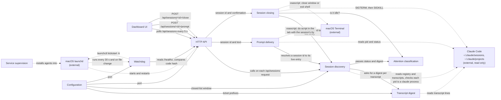

# Design index: `claude-dash`

This folder is the design that the code is built against. Code is generated from the design, not the other way round: AI-generated code is not deterministic, so the design has to be, or there is nothing stable for tests, reviews or the next regeneration to check against.

## Working with this folder

1. **Name the concepts a change touches** before writing code. A concept not in the table below is a new concept.
2. **Update the design first.** Change the concept file's boundaries, interactions and acceptance criteria. New concepts start from [`templates/concept.md`](templates/concept.md). Any new or changed interaction also goes in the coordination map below. Record the change in [`changelog.md`](changelog.md).
3. **Build against the updated design.** If an interaction isn't fully built, mark it `designed` or `partial` and list it under the concept's "Known implementation gaps". Never leave something marked `implemented` that isn't.
4. **Tests come from acceptance criteria.** Unit tests from one concept's criteria, integration tests from the edges in the coordination map. When fixing a defect, correct the criterion first, add the regression test, then fix the code.
5. **Design and code land in the same commit.**

## Concepts

| Concept | File | One-line purpose |
| --- | --- | --- |
| Session discovery | [`concepts/session-discovery.md`](concepts/session-discovery.md) | Finds the open sessions and the recently closed ones, and the transcript for each |
| Transcript digest | [`concepts/transcript-digest.md`](concepts/transcript-digest.md) | Reduces a session transcript to what a card needs: title, summary, last prompt, tickets, cost |
| Attention classification | [`concepts/attention-classification.md`](concepts/attention-classification.md) | Decides whether a session is waiting on you, working, idle or closed |
| Configuration | [`concepts/configuration.md`](concepts/configuration.md) | Local settings in `.env`, kept out of the repository |
| HTTP API | [`concepts/http-api.md`](concepts/http-api.md) | The localhost server: dashboard page, session data and health |
| Dashboard UI | [`concepts/dashboard-ui.md`](concepts/dashboard-ui.md) | The page that groups, filters and refreshes session cards, and composes replies |
| Prompt delivery | [`concepts/prompt-delivery.md`](concepts/prompt-delivery.md) | Types a reply into a waiting session's Terminal tab, as if you had typed it |
| Session closing | [`concepts/session-closing.md`](concepts/session-closing.md) | Stops a session's process and closes its Terminal window, leaving it resumable |
| Service supervision | [`concepts/service-supervision.md`](concepts/service-supervision.md) | Runs the server as a per-user LaunchAgent that restarts on exit |
| Watchdog | [`concepts/watchdog.md`](concepts/watchdog.md) | Restarts the server when it hangs or when its code or settings change |

## Coordination map

Dotted edges cross the boundary of this repository.

## Concepts owned elsewhere, referenced here

| Concept | Owner | Why this project depends on it |
| --- | --- | --- |
| Session registry (`~/.claude/sessions/<pid>.json`) | Claude Code (internal, undocumented) | The only source of which sessions are running and whether each is idle or busy |
| Session transcripts (`~/.claude/projects/*/<session id>.jsonl`) | Claude Code (internal, undocumented) | The source of titles, away summaries, prompts and cost |
| LaunchAgents | macOS launchd | Starts, restarts and schedules the two processes |
| Terminal scripting | macOS Terminal | Typing a prompt into a session's tab; needs your permission for the server to control Terminal |

Both Claude Code sources are internal state, not a published interface. The design was written against Claude Code 2.1.325.

Where a version has been observed to differ, the concept records it rather than the design assuming one version. Measured 16-11-2026 against both versions installed that day:

| Observation | Versions | Concept | Effect |
| --- | --- | --- | --- |
| `cost-state` records absent | 2.1.220 | [Transcript digest](concepts/transcript-digest.md) | No cost is shown on any card |
| `cost-state` records present, carrying `totalCostUSD` and a `modelUsage` breakdown | 2.1.325 | [Transcript digest](concepts/transcript-digest.md) | Cost is shown; a recorded zero shows as `US$0.00`, an absent record shows nothing |
| Registry `status` can be `shell`, not just `idle` or `busy` | 2.1.220 | [Attention classification](concepts/attention-classification.md) | Such a session is labelled idle; it is no longer offered a reply box |
| The process name is rewritten: a background job reports `claude bg-spare`, and `ps -o ucomm=` reports the version string | 2.1.220, 2.1.325 | [Session discovery](concepts/session-discovery.md) | Session identity is checked against `procStart`, never the process name |
| One transcript can hold records from several versions when a session is resumed across an upgrade | 2.1.220 + 2.1.325 | [Transcript digest](concepts/transcript-digest.md) | A record's presence is a property of the record, not of the installed version |
